# Lab 7: Docker Containers and Images

**Student:** sadia612  
**Date:** 17 November 2026  
**Environment:** Ubuntu 26.04.1 LTS virtual machine, Docker 29.1.3, Docker Compose v5.7.1

In this lab Docker Engine and the Docker Compose plug-in were installed, two PostgreSQL versions and two NGINX versions were run in containers, containers and images were inspected and cleaned up, and the changes made inside an NGINX container were saved as a new image (`nginx:myimage`).

## Contents

| Task | Topic |
|------|-------|
| [Task 1](#task-1-install-docker-and-docker-compose) | Install Docker and Docker Compose |
| [Task 2](#task-2-run-two-postgresql-versions-in-docker) | Run two PostgreSQL versions |
| [Task 3](#task-3-inspect-docker-and-manage-containers-and-images) | Inspect Docker, manage containers and images |
| [Task 4](#task-4-run-two-nginx-containers-on-different-ports) | Two NGINX containers on different ports |
| [Task 5](#task-5-work-inside-a-container-and-save-a-new-image) | Work inside a container, save a new image |

---

## Task 1: Install Docker and Docker Compose

```bash
sudo apt install -y docker.io
sudo mkdir -p /usr/local/lib/docker/cli-plugins
sudo curl -SL https://github.com/docker/compose/releases/latest/download/docker-compose-linux-x86_64 \
    -o /usr/local/lib/docker/cli-plugins/docker-compose
sudo chmod +x /usr/local/lib/docker/cli-plugins/docker-compose
sudo systemctl start docker
sudo usermod -aG docker $USER
```

After signing out and back in:

```bash
docker --version
docker compose version
```

Docker **29.1.3** and Docker Compose **v5.7.1** are installed.

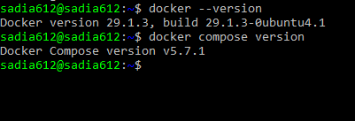

---

## Task 2: Run Two PostgreSQL Versions in Docker

### Pull the image and run it without a password

```bash
docker pull postgres:9.6
docker run postgres:9.6
```

The container exits with an error because `POSTGRES_PASSWORD` was not specified.

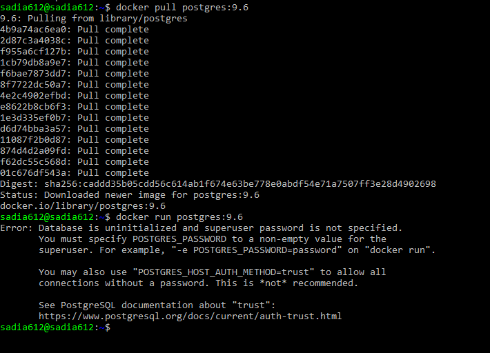

### Run PostgreSQL 9.6 with a password

```bash
docker run -d -e POSTGRES_PASSWORD=password postgres:9.6
docker ps
```

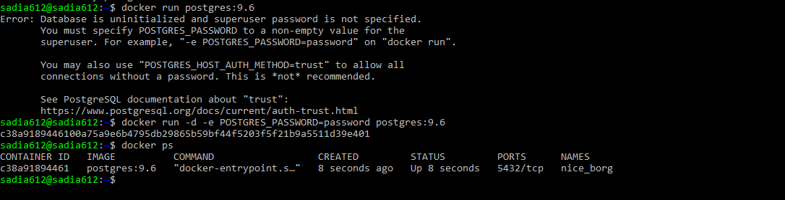

### Run PostgreSQL 10.10 as well

```bash
docker run -d -e POSTGRES_PASSWORD=password postgres:10.10
docker ps
```

Both containers show the status `Up`.

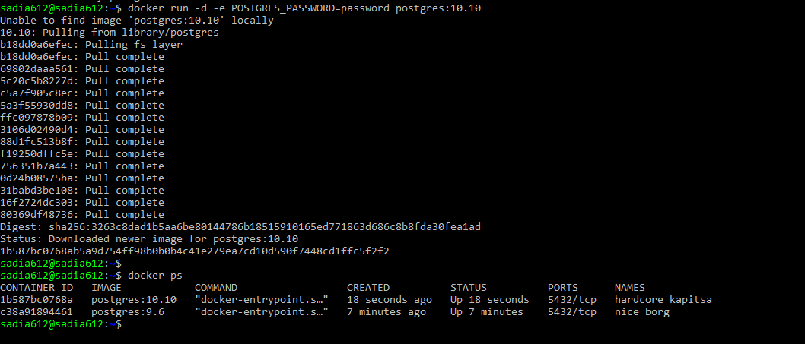

---

## Task 3: Inspect Docker and Manage Containers and Images

### Docker installation details

```bash
docker info
```

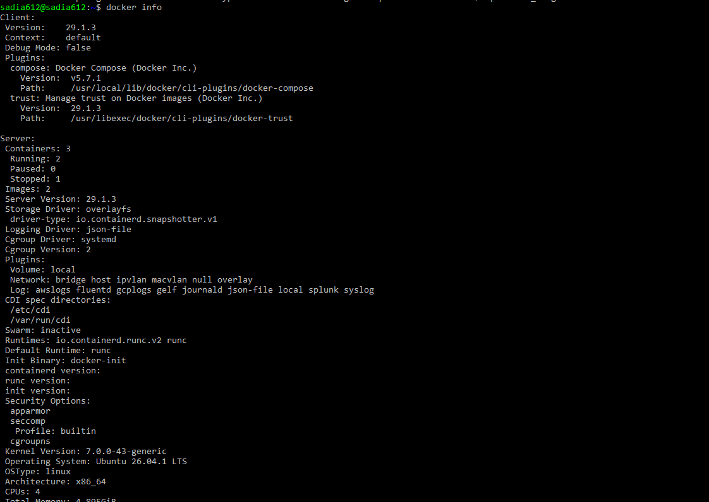

### Search Docker Hub

```bash
docker search ubuntu
```

The first result is the official `ubuntu` image.

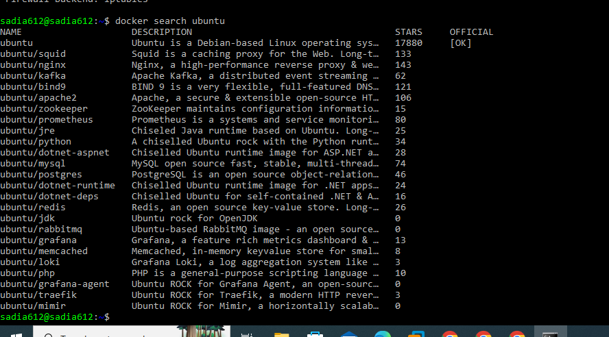

### Running and stopped containers

```bash
docker images
docker run -d ubuntu
docker ps
docker ps -a
```

The Ubuntu container exits immediately because its default process (`/bin/bash`) has no interactive session. It is missing from `docker ps` (running containers only) and appears as `Exited (0)` in `docker ps -a`.

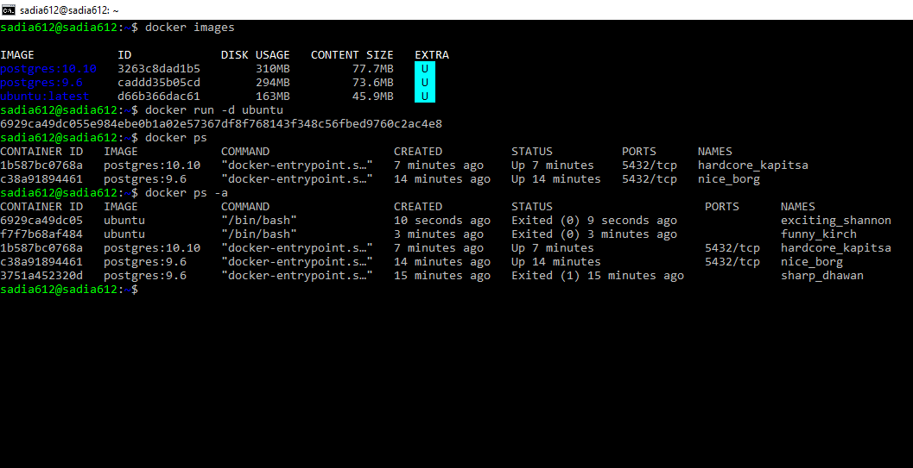

### Restart, stop and remove PostgreSQL 9.6

A new `postgres:9.6` container was created with the name `pg96` for this step.

```bash
docker restart pg96
docker stop pg96
docker rm pg96
docker rmi postgres:9.6
```

The `postgres:10.10` container was left running.

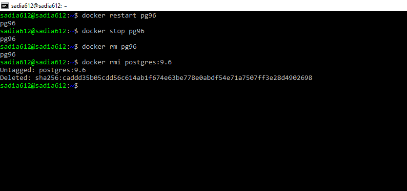

---

## Task 4: Run Two NGINX Containers on Different Ports

```bash
docker run -dit -p 6001:80 --name nginx-latest nginx
docker run -d -p 6002:80 --name nginx-older nginx:1.30.6
```

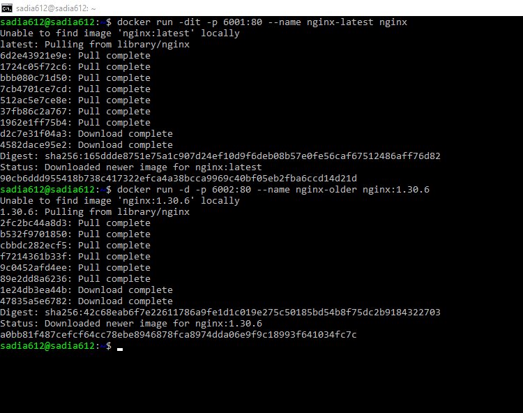

### Welcome pages

`http://192.168.47.131:6001` (nginx-latest):

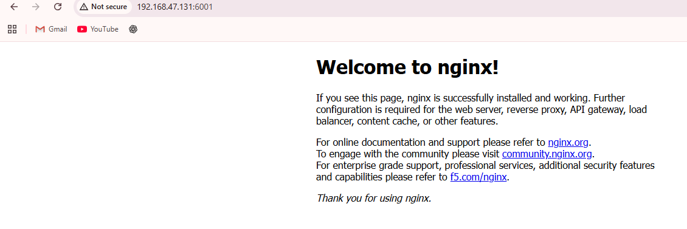

`http://192.168.47.131:6002` (nginx-older):

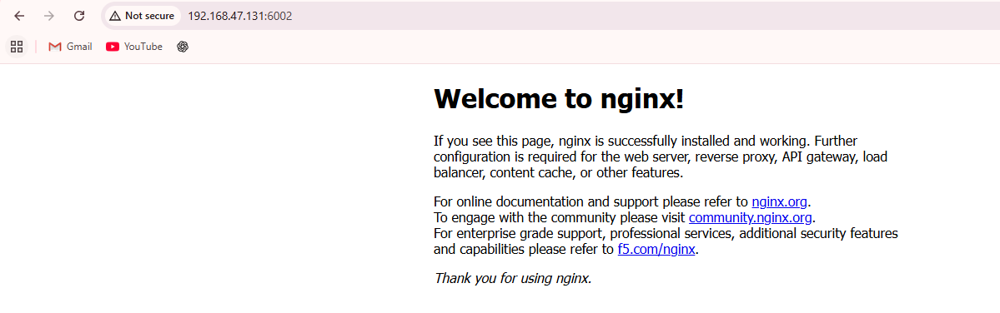

### Container logs

```bash
docker logs nginx-latest
```

The log contains the browser request `GET / HTTP/1.1" 200` from `192.168.47.1`.


---

## Task 5: Work Inside a Container and Save a New Image

### Attach and detach

```bash
docker attach nginx-latest
```

Refreshing the port 6001 page produced new requests in the attached terminal. `Ctrl+P` then `Ctrl+Q` detached while NGINX kept running.

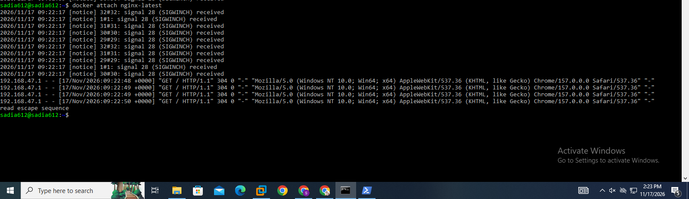

### Open a shell and change files

```bash
docker exec -it nginx-latest /bin/sh
ls /
touch /usr/share/nginx/html/newfile.html
touch /usr/share/nginx/html/oldfile.html
rm /usr/share/nginx/html/oldfile.html
printenv
exit
```

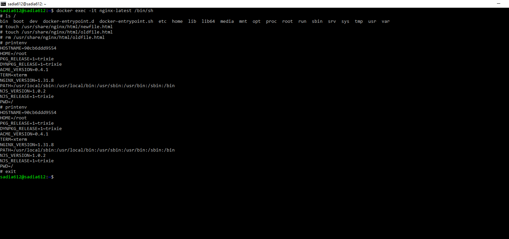

### Filesystem changes

```bash
docker diff nginx-latest
```

`newfile.html` is listed as added (`A`). `oldfile.html` does not appear because it was created and removed in the same session.

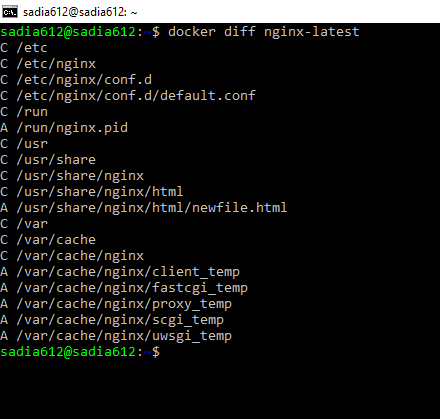

### Inspect the container

```bash
docker inspect nginx-latest | head -40
```

The `State` block shows `"Status": "running"`.

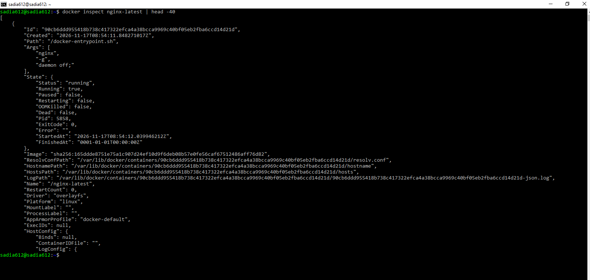

### Save the container as a new image

```bash
docker commit nginx-latest nginx:myimage
```

Docker created the image `nginx:myimage` and printed its image ID.

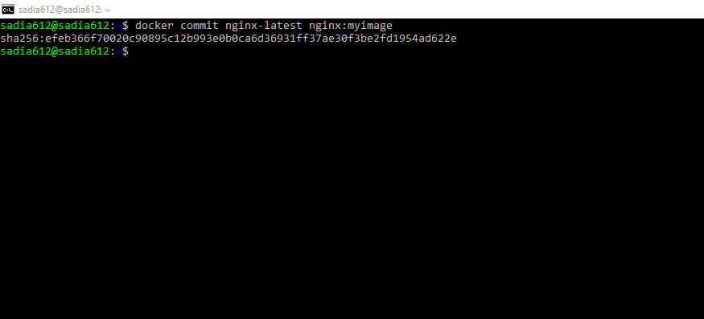

---

## Summary

- Docker 29.1.3 and Docker Compose v5.7.1 were installed and verified.
- The PostgreSQL missing-password error was observed, then `postgres:9.6` and `postgres:10.10` were run side by side.
- Docker was inspected, Docker Hub was searched and the exited Ubuntu container was found with `docker ps -a`.
- The PostgreSQL 9.6 container was restarted, stopped and removed, and its image tag was deleted.
- Two NGINX versions were published on ports 6001 and 6002 and the request log was checked.
- Inside `nginx-latest` a file was added, the changes were inspected with `docker diff` and `docker inspect`, and the result was saved as `nginx:myimage`.
